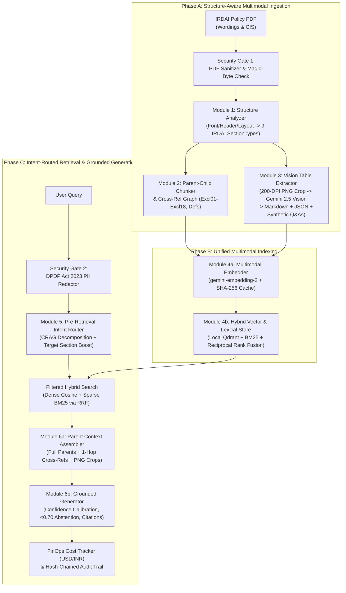

# Indian Insurance Policy Multimodal RAG System

[](https://github.com/vinailead/multimodalrag/actions/workflows/ci.yml)
[](https://python.org)
[](https://typescriptlang.org)
[](https://fastapi.tiangolo.com)
[](https://streamlit.io)
[](https://m3.material.io)
[](https://pytest.org)
[](https://vitest.dev)
[](https://bandit.readthedocs.io)
[](LICENSE)

An enterprise-grade, production-hardened **Multimodal Retrieval-Augmented Generation (RAG) System** purpose-built for **Indian Health & General Insurance Policies** governed by the **Insurance Regulatory and Development Authority of India (IRDAI)** and the **Digital Personal Data Protection (DPDP) Act 2023**.

Powered by **Gemini 2.5 Flash & Pro**, **PyMuPDF**, **Local Qdrant**, and **BM25Okapi**, this system overcomes the critical failure modes of conventional naive RAG pipelines on complex legal policy wordings: merged table headers, multi-page schedule-of-benefits, cross-clause dependencies (`Excl01`–`Excl18`), sub-limits, and waiting periods.

---

## 🏛️ System Architecture



---

## 🚀 Key Modules & Innovations

### 1. Pre-Chunking Structure Analyzer (`Module 1`)
- Scans layout, font weights, and bounding boxes via PyMuPDF.
- Maps text blocks into **9 IRDAI Section Categories**: `Preamble`, `Definitions`, `Base_Coverage`, `Schedule_of_Benefits`, `Waiting_Periods`, `Exclusions`, `General_Conditions`, `Grievance_Redressal`, and `Customer_Information_Sheet (CIS)`.

### 2. Parent-Child Hierarchical Chunker & Cross-Reference Graph (`Module 2`)
- **Parent Chunks**: Logical sections (600–2,500 tokens) preserved for contextual synthesis.
- **Child Chunks**: Granular clauses (80–250 tokens) indexed for high-precision retrieval.
- **Cross-Reference Graph Resolver**: Detects citations between exclusion codes (`Code-Excl01` to `Code-Excl18`), sub-clause numbers, and defined terms, automatically pulling 1-hop dependencies into the prompt.

### 3. Vision Table Extraction with High-DPI Visual Crops (`Module 3`)
- Extracts benefit tables with 200-DPI PNG crops.
- Uses Gemini 2.5 Vision to reconstruct clean Markdown tables, JSON row arrays, and synthetic Q&A pairs.
- Displays visual crops directly in the UI's **Right Visual Grounding Inspector**.

### 4. Hybrid Multimodal Indexing (`Module 4`)
- Combines **Dense Vector Embeddings** (Qdrant) and **Sparse Lexical Search** (BM25Okapi).
- Merges rankings via **Reciprocal Rank Fusion (RRF)** with specialized boosts for exclusion codes (+0.05) and tabular data (+0.02).
- Section boost (+0.04) prevents retrieval blindness while maintaining strict multi-tenant policy isolation.

### 5. Pre-Retrieval Intent Router & Corrective RAG (CRAG) (`Module 5`)
- Decomposes complex comparative questions into focused sub-queries.
- Routes surgical procedures (e.g., cataract, hernia, joint replacement) across both `Waiting_Periods` and `Schedule_of_Benefits`.

### 6. Calibrated Grounded Generation & Deterministic Abstention (`Module 6`)
- Executive **Direct Answers** with status badges (`🟢 FULLY COVERED`, `🟡 COVERED WITH LIMITS`, `⏳ WAITING PERIOD APPLIES`, `🔴 EXCLUDED`).
- Multi-factor confidence score ($0.45 \cdot S_{\text{retrieval}} + 0.35 \cdot S_{\text{llm}} + 0.20 \cdot S_{\text{citations}}$).
- **Deterministic Abstention**: Queries with confidence $< 0.70$ safely abstain with IRDAI-compliant legal notices.

### 7. Conversational Probing Underwriter, Multi-Policy Comparator & Claim Simulator (`V2 Product Engine`)
- **Needs-Discovery Probing Advisor (`RecommendationEngine`)**: Parses applicant personas (e.g., *"I am individual with age 26, non smoker and non drinker with family of 5 what is the best policy for me"*), generates targeted follow-up questions (`includes_parents`, `has_pre_existing_diseases`, `city_tier`, `budget_priority`), detects the Indian **Family Floater Eldest-Member Age Trap** (`evaluate_portfolio_split`), and ranks policies with indicative GST-inclusive annual/monthly ₹ premiums and non-smoker/non-drinker discounts.
- **Clause-Grounded Multi-Policy Comparator (`PolicyComparator`)**: Compares all listed providers side-by-side across 10 IRDAI dimensions with winner badges (`★ Best`) and PDF page citations.
- **Hospital Bill Out-of-Pocket Simulator (`ClaimSimulator`)**: Models exact insurer payable vs. user out-of-pocket ₹ across policies for realistic hospital stays (room rent proportionate deduction, cataract sub-limits, ~8% non-medical consumables, and mandatory co-pay).

---

## 🔒 Security, Privacy & FinOps Governance

- **DPDP Act 2023 PII Redactor**: Automatically sanitizes Aadhaar numbers, PAN cards, Indian mobile numbers, policy numbers, and email addresses before prompt assembly.
- **PDF Sanitizer**: Validates PDF magic bytes, detects malicious JavaScript streams, and intercepts indirect prompt-injection attempts.
- **Content-Addressable SHA-256 Cache**: Deduplicates identical image and prompt requests for $0.00 / ₹0.00 token cost.
- **FinOps Telemetry**: Dual USD/INR real-time cost tracking with automated budget circuit breakers.
- **Audit Trail**: Immutable, hash-chained log (`logs/audit_trail.jsonl`) recording every query, model invocation, and redaction event.

---

## 🖥️ User Interfaces

The repository provides two complementary UI experiences:

1. **Google Material Design 3 Web UI**:
   - 3-pane layout: Policy selector, Query chat with OpenTelemetry waterfall trace, and Right Visual Grounding Inspector.
   - Built with pure modern TypeScript, Material 3 CSS tokens, and zero heavy frameworks.
2. **Streamlit Showcase Dashboard** (`ui/streamlit_app.py`):
   - Fast, interactive prototyping dashboard with instant keyboard submit (`Enter`), pre-configured IRDAI sample queries, and visual crop inspection.

---

## 📂 Repository Directory Map

```
multimodalrag/
├── .agent/skills/                  # Reusable Agent Skill definitions
│   └── indian-insurance-mmrag/     # Domain architecture & rules
├── .github/workflows/              # Continuous Integration (GitHub Actions)
│   └── ci.yml                      # Full 10-step ADLC quality checks
├── data/
│   ├── raw_policies/               # Authentic IRDAI policy PDFs & manifest.json
│   └── cache/                      # Content-addressable PNG table crops & embeddings
├── docs/                           # Comprehensive Engineering & Domain Documentation
│   ├── ARCHITECTURE.md             # Deep dive into the 6 multimodal modules
│   ├── COST_FINOPS.md              # Gemini 2.5 pricing, caching & budget breaker
│   ├── DESIGN_SYSTEM.md            # Google Material Design 3 UI tokens & guidelines
│   ├── GOVERNANCE.md               # IRDAI regulatory compliance & abstention rules
│   ├── PLAN.md                     # 6-Phase implementation plan with verified criteria
│   ├── PROBLEM_STATEMENT.md        # Indian Insurance domain nuances & RAG pitfalls
│   ├── RECURSIVE_WORKFLOW_LOG.md   # Architectural discovery & mutation log
│   ├── SECURITY.md                 # DPDP Act 2023 PII masking & injection defense
│   ├── SPEC.md                     # Data models, schemas & REST API contracts
│   ├── STATUS.md                   # Live phase status & test coverage ledger
│   └── TESTING.md                  # Quality gate definitions & Playwright setup
├── e2e/                            # Playwright end-to-end browser test suite
├── notebooks/                      # Interactive Jupyter execution showcase
├── scripts/                        # Cross-platform Node.js automation scripts
│   ├── check.mjs                   # Master quality gate runner (Python + TS + E2E)
│   ├── dev.mjs                     # Dual dev server (FastAPI + Vite)
│   ├── fetch_irdai_policies.py     # Live policy downloader & sanitizer
│   └── install-hooks.mjs           # Git pre-commit hook installer
├── src/insurance_mmrag/            # Core Python Library
│   ├── api/                        # FastAPI REST application (/api/v1)
│   ├── domain/                     # IRDAI taxonomy, exclusion codes & cues
│   ├── evals/                      # RAG Triad Scorecard Benchmark Runner
│   ├── generation/                 # Grounded generator & calibrated confidence
│   ├── indexing/                   # Multimodal embedder & Hybrid Vector Store
│   ├── ingestion/                  # Structure analyzer, chunker, & table parser
│   ├── llm/                        # Gemini 2.5 gateway, client & protocol
│   ├── security/                   # DPDP PII redactor & PDF sanitizer
│   └── telemetry/                  # Cost tracker, trace recorder & audit logger
├── tests/                          # 65 Pytest unit and integration tests (94.5% coverage)
├── ui/
│   ├── streamlit_app.py            # Streamlit interactive application
│   └── web/                        # Material 3 TypeScript application
│       ├── src/                    # Components, state, types & styles
│       └── index.html              # M3 responsive application shell
├── AGENTS.md                       # ADLC charter & non-negotiable engineering rules
├── LICENSE                         # MIT License
├── package.json                    # Node dependencies, scripts & Playwright config
├── pyproject.toml                  # Python package configuration, dependencies & tools
└── README.md                       # Project documentation
```

---

## ⚡ Quick Start

### 1. Prerequisites
- **Python**: `>= 3.12` with [uv](https://github.com/astral-sh/uv)
- **Node.js**: `>= 20.0` with `npm`

### 2. Installation
```bash
# Clone the repository
git clone https://github.com/vinailead/multimodalrag.git
cd multimodalrag

# Install Python & Node dependencies (automatically sets up git pre-commit hook)
uv sync
npm install
```

### 3. Launching Applications

#### Streamlit Dashboard
```bash
uv run streamlit run ui/streamlit_app.py
```
*Access at: `http://localhost:8501`*

#### FastAPI Backend + Material Design 3 Web UI
```bash
npm run dev
```
*FastAPI Swagger docs at: `http://localhost:8000/docs`*  
*M3 Dashboard at: `http://localhost:5173`*

### 4. Running the CLI
```bash
# Query the indexed policy
uv run mmrag query "Is cataract surgery covered or excluded?" --doc-id arogya_sanjeevani_national

# Run Quantitative RAG Triad Benchmark
uv run mmrag benchmark

# Ingest an authentic IRDAI PDF
uv run mmrag ingest data/raw_policies/arogya_sanjeevani_policy_wordings.pdf --doc-id arogya_sanjeevani_national
```

---

## 🧪 Quality Gates & Testing Charter

This project enforces strict **Agentic Development Lifecycle (ADLC)** quality gates. Every change is verified against 10 automated checks before commit:

```bash
# Run all 10 quality gates (Python, TypeScript, SAST, Vitest, Playwright E2E)
npm run check

# Run Python checks only (Ruff, Pyright, Bandit, Pytest >= 80% coverage)
npm run check:py

# Run TypeScript checks only (ESLint, Prettier, tsc, Vitest >= 80% coverage)
npm run check:ts

# Run Playwright E2E browser tests
npm run test:e2e
```

| Quality Gate | Tool | Status / Threshold |
| :--- | :--- | :--- |
| Python Lint | `ruff check` | **100% Clean** |
| Python Formatting | `ruff format --check` | **100% Formatted** |
| Static Type Checking | `pyright` (strict) | **0 Errors, 0 Warnings** |
| SAST Security Scan | `bandit` | **0 Issues Identified** |
| Python Unit / API Tests | `pytest` | **65 passed, 94.5% coverage** |
| TypeScript Lint | `eslint` | **0 Errors** |
| TypeScript Formatting | `prettier --check` | **100% Formatted** |
| TypeScript Compiler | `tsc --noEmit` | **0 Errors** |
| TypeScript Unit Tests | `vitest` | **22 passed, 99.6% coverage** |
| Browser E2E Tests | `playwright` | **6/6 Chromium tests passed** |

---

## 📄 License

This project is licensed under the terms of the [MIT License](LICENSE).
