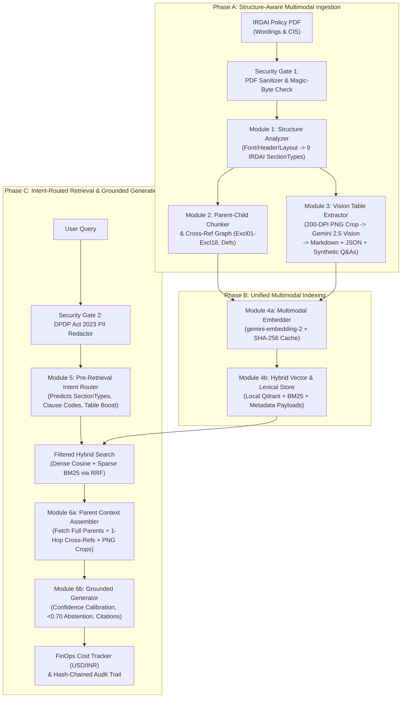

# docs/ARCHITECTURE.md — Deep-Dive Into the 6 Core Multimodal Elements

---

## Element 1: Pre-Chunking Structure Analysis Pass (`structure_analyzer.py`)

Before any text is split, `StructureAnalyzer` inspects every page of the PDF:
1. Extracts text spans with font size, bold weight, bounding boxes, and table regions via `PyMuPDF` (`fitz`).
2. Identifies section headers using a dual heuristic + LLM classification pass:
   - Recognizes IRDAI standard markers: *"Customer Information Sheet"*, *"Part A / Part B / Part C"*, *"Schedule of Benefits"*, *"Standard Definitions"*, *"Specific Definitions"*, *"Waiting Periods"*, *"Excl01"–"Excl18"*, *"Claim Procedure"*, *"Grievance Redressal / Bima Bharosa"*.
   - Maps each contiguous section to one of the 9 `SectionType` categories.

---

## Element 2: Parent-Child Chunker & Cross-Reference Graph (`parent_child_chunker.py` & `cross_ref_resolver.py`)

- **Parent Chunks (`ParentChunk`)**: Represent an entire logical policy section or sub-section (typically 600–2,500 tokens). Stored in the Parent Document Store keyed by `parent_id`.
- **Child Chunks (`ChildChunk`)**: Represent individual numbered clauses, sub-clauses, individual defined terms, or individual table Q&A pairs (typically 80–250 tokens). Every child stores `parent_id` in its `ChunkMetadata`.
- **Cross-Reference Graph Resolver (`CrossReferenceResolver`)**:
  - Scans every `ParentChunk` and `ChildChunk` for explicit references to:
    - IRDAI Exclusion codes (`Excl01` to `Excl18`)
    - Section/Clause numbers (`Section 4.2`, `Clause 5.1(a)`)
    - Capitalized Defined Terms present in the policy's `Definitions` section (e.g., *Pre-Existing Disease*, *Proportionate Deduction*, *AYUSH Day Care Centre*, *Cashless Facility*)
  - Links those references to the target `parent_id`s in `metadata.cross_references`.

---

## Element 3: Table Vision Extraction & Context Enrichment (`table_vision_parser.py`)

Standard text extraction ruins insurance benefit tables. `TableVisionParser` executes a 4-step pipeline for every detected table:
1. **High-Resolution Visual Crop**: Renders the table bounding box (plus a 16px margin to capture footnotes above/below) at 200 DPI into `data/cache/crops/{doc_id}_p{page}_t{idx}.png`.
2. **Content-Addressable SHA-256 Lookup**: Hashes the cropped image bytes. If already parsed in `data/cache/tables/`, returns the cached artifact immediately at `$0.00 / ₹0.00` cost.
3. **Gemini 2.5 Vision Extraction**: Sends the PNG bytes to `gemini-2.5-flash` with a strict `ExtractedTableArtifact` Pydantic response schema to produce:
   - Clean Markdown table with all merged headers explicitly aligned
   - Structured JSON row dicts
   - Extracted footnotes (`*`, `**`)
   - A descriptive title and 1-sentence executive summary
   - 5–10 synthetic Question-Answer pairs covering specific plan tiers, sum-insured limits, and sub-limits
4. **Dual Indexing**: Indexes both the full table summary/Markdown and each synthetic Q&A pair as `ChildChunk` entries (`chunk_type=ChunkType.TABLE`) pointing to the parent section and the `image_crop_path`.

---

## Element 4: Multimodal Indexing & Hybrid Vector Store (`multimodal_embedder.py` & `vector_store.py`)

- **Multimodal Embedder**: Generates normalized embeddings for text chunks, table representations, and image crops using `gemini-embedding-2-preview` (or `StubGeminiClient` in tests).
- **Hybrid Retrieval (Dense Qdrant + Sparse BM25 via RRF)**:
  - Dense semantic search excels at conceptual queries (*"Will my hospital bill be cut if I pick a single private AC room?"*).
  - Sparse BM25 excels at exact regulatory tokens (*"Excl01"*, *"IRDAN000RP0001V01202021"*, *"AYUSH"*).
  - **Reciprocal Rank Fusion (RRF)**:
    $$\text{RRF\_Score}(d) = \frac{w_{\text{dense}}}{k + \text{rank}_{\text{dense}}(d)} + \frac{w_{\text{bm25}}}{k + \text{rank}_{\text{bm25}}(d)} + \mathbb{I}(\text{table\_boost}) \cdot \beta$$

---

## Element 5: Pre-Retrieval Intent Router (`intent_router.py`)

Before querying the vector store, `IntentRouter` analyzes the PII-redacted user query:
1. Predicts `primary_section` and `target_sections` (subset of `SectionType`).
2. Extracts any explicit clause/exclusion codes (`Excl01`–`Excl18`).
3. Sets `requires_table_boost = True` if the query asks about numerical limits, slabs, percentages, co-payments, sum insured, or sub-limits.
4. Sets `requires_pro_escalation = True` if the query requires synthesizing across $\ge 3$ distinct policy sections (e.g., *Coverage + Waiting Period + Proportionate Deduction*).

---

## Element 6: Context Assembly & Grounded Generation (`context_assembler.py` & `grounded_generator.py`)

1. **Parent Promotion**: Deduplicates the `parent_id`s of the top-$k$ matching `ChildChunk`s and loads the full, untruncated `ParentChunk` text.
2. **1-Hop Cross-Reference Expansion**: Loads any `ParentChunk` referenced in `metadata.cross_references` (e.g., pulling the exact definition of *Pre-Existing Disease* and *Proportionate Deduction*).
3. **Multimodal Prompt Assembly**: Attaches both the textual Parent Chunks and the raw PNG table/page crops (`Part.from_bytes`) so Gemini 2.5 sees the exact visual layout alongside the legal text.
4. **Confidence Calibration & Deterministic Abstention**:
   $$\text{Confidence} = 0.45 \cdot S_{\text{retrieval}} + 0.35 \cdot S_{\text{llm\_grounding}} + 0.20 \cdot S_{\text{citation\_verification}}$$
   - If $\text{Confidence} < 0.70$ (or if no chunks survive relevance thresholding), the system sets `abstained = True` and returns a mandatory IRDAI-compliant fallback message stating that coverage details cannot be deterministically verified from the provided policy document.
