# docs/DESIGN_SYSTEM.md — Google Material Design 3 (M3) Visual & UI Specification

The Web UI (`ui/web/`) and Streamlit Showcase (`ui/streamlit_app.py`) follow the **Google Material Design 3 (M3)** specification, engineered for high readability of dense legal insurance clauses, tabular schedules, and visual citations.

---

## 1. Material Design 3 Color Tokens (`material3.css`)

```css
:root {
  /* Primary Palette (Google Blue) */
  --md-sys-color-primary: #0b57d0;
  --md-sys-color-on-primary: #ffffff;
  --md-sys-color-primary-container: #d3e3fd;
  --md-sys-color-on-primary-container: #041e49;

  /* Secondary & Surface Tones */
  --md-sys-color-secondary: #00639b;
  --md-sys-color-secondary-container: #c2e7ff;
  --md-sys-color-surface: #f8fafd;
  --md-sys-color-surface-container-lowest: #ffffff;
  --md-sys-color-surface-container-low: #f0f4f9;
  --md-sys-color-surface-container: #e9eef6;
  --md-sys-color-surface-container-high: #dde3ea;
  --md-sys-color-on-surface: #1f1f1f;
  --md-sys-color-on-surface-variant: #444746;
  --md-sys-color-outline: #747775;
  --md-sys-color-outline-variant: #c4c7c5;

  /* Semantic Regulatory & Confidence Tokens */
  --md-sys-color-verified-bg: #e6f4ea;
  --md-sys-color-verified-text: #137333;
  --md-sys-color-warning-bg: #fef7e0;
  --md-sys-color-warning-text: #b06000;
  --md-sys-color-error-bg: #fce8e6;
  --md-sys-color-error-text: #c5221f;

  /* Elevation & Shape */
  --md-sys-shape-corner-small: 8px;
  --md-sys-shape-corner-medium: 12px;
  --md-sys-shape-corner-large: 16px;
  --md-sys-shape-corner-full: 9999px;
}
```

---

## 2. Typography Scale

- **Display / Headlines / UI Navigation**: `'Google Sans'`, `'Inter'`, system-ui (`font-weight: 500–600`)
- **Legal Policy Clauses & Grounded Answers**: `'Roboto'`, sans-serif (`15px`, `line-height: 1.65`, optimal 68ch measure)
- **IRDAI Clause Codes (`Excl01`), UINs, Confidence Scores & FinOps Telemetry**: `'Roboto Mono'`, monospace (`13px`)

---

## 3. Three-Pane Enterprise Workspace Layout

```mermaid
flowchart LR
    subgraph LeftDrawer["1. Left Navigation Rail (300px)"]
        P_SEL["Indexed IRDAI Policy Selector\n(Arogya Sanjeevani, CIS, UIN Badge)"]
        FIN["Live FinOps Card\n($ USD / ₹ INR Spend, Cache Hit %)"]
        SEC["DPDP Act 2023 & IRDAI\nGovernance Status Card"]
    end

    subgraph CenterWorkspace["2. Center Grounded Q&A Workspace (Fluid)"]
        Q_BAR["M3 Search Bar + Sample IRDAI Query Pills"]
        PII_BAN["DPDP PII Redaction Alert Banner (Conditional)"]
        INT_CHIPS["Pre-Retrieval Intent Routing M3 Assist Chips"]
        ANS_CARD["Grounded Answer Card + Confidence Meter Badge\n(or Red IRDAI Abstention Banner if < 0.70)"]
        COV_GRID["Structured Policy Breakdown Grid\n(Coverage Status | Waiting Period | Sub-limits | Exclusions)"]
        CIT_LIST["Interactive Citation Filter Chips (Page, Section, Excl Code)"]
    end

    subgraph RightInspector["3. Right Visual Grounding Inspector (420px)"]
        IMG_VIEW["200-DPI Cropped Table / Page Snapshot Viewer"]
        PAR_VIEW["Full Parent Section Context + Highlighted Child Clause"]
        XREF_VIEW["1-Hop Cross-Referenced Definitions & Exclusions"]
    end

    LeftDrawer --- CenterWorkspace --- RightInspector
```



---

## 4. Accessibility & Interactive States
- All interactive elements meet **WCAG 2.1 AA** contrast ratios ($\ge 4.5:1$) and include explicit `aria-label`, `role`, and keyboard focus rings (`2px solid var(--md-sys-color-primary)`).
- Every citation chip has a `data-testid="citation-chip-{index}"` attribute for deterministic Playwright E2E verification.
