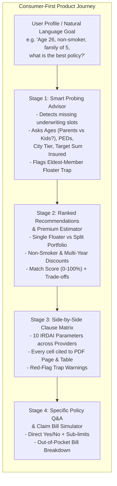
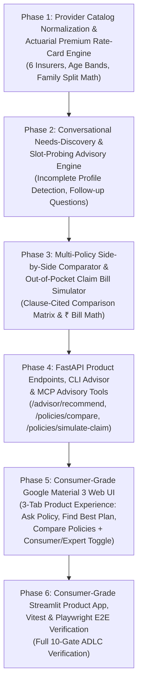

# docs/PLAN.md — Product Strategy, Market Landscape & 6-Phase Consumer Product Plan

> [!IMPORTANT]
> **Product Evolution Charter (V2 — Consumer-Grade AI Insurance Advisor, Multi-Policy Comparator & Clause-Grounded Q&A)**:
> While V1 proved the deep multimodal RAG engineering foundation (structure analysis, parent-child chunking, Gemini 2.5 Vision table extraction, hybrid Qdrant+BM25 RRF, DPDP Act 2023 PII redaction, and $<0.70$ abstention), V2 transforms the platform into a **consumer-friendly, fiduciary-grade InsurTech product** combining:
> 1. **Conversational Needs-Discovery & Probing Advisor**: Detects incomplete user profiles (e.g., *"Age 26, non-smoker, non-drinker, family of 5 — what is the best policy for me?"*) and proactively asks targeted follow-up questions (family member ages/parents vs. kids, pre-existing conditions, city tier, Sum Insured budget) while warning against Indian health insurance traps like putting aging parents on a young adult's family floater.
> 2. **Indicative Premium & Portfolio-Split Calculator**: Calculates realistic GST-inclusive annual/monthly premiums across insurers, Sum Insured tiers (₹5L–₹50L), non-smoker/healthy-lifestyle discounts, and compares **Single Family Floater vs. Split Portfolio (Self/Spouse/Kids + Separate Parent Policy)**.
> 3. **Clause-Grounded Multi-Policy Comparison Engine**: Side-by-side comparison across all listed providers (*HDFC ERGO Optima Secure*, *Tata AIG MediCare Premier*, *Bajaj Allianz Health Guard*, *Go Digit Health Plus*, *National Insurance Arogya Sanjeevani*, *Saral Suraksha Bima*) with every cell backed by verbatim PDF citations and page numbers.
> 4. **Consumer-First Policy Q&A & Out-of-Pocket Claim Simulator**: Plain-language answers for any specific policy or across all policies, complete with a *"What will I pay on a ₹2L hospital bill?"* calculator and a clean **Consumer Mode vs. Legal/Engineering Inspector Mode** toggle.

---

## Part 1: Indian InsurTech Market Landscape & Product Strategy (2025–2026)

### 1.1 Ecosystem Landscape & The Consumer Trust Gap

India's retail health insurance market (~₹1.15 Lakh Crore GWP, growing at ~18% CAGR) is undergoing a structural shift driven by the **IRDAI (Insurance Products) Regulations & Master Circular (2024–2025)** (which capped PED waiting periods at 36 months, mandated standardized Customer Information Sheets, and enforced strict claim settlement timelines) and **Bima Sugam** (India's upcoming Digital Public Infrastructure for insurance issuance and portability).

Despite these regulatory advances, consumers face a broken buying and post-purchase experience across existing market categories:

| Market Category | Key Players | Core Strength | Fatal Consumer Pain Point / White Space |
| :--- | :--- | :--- | :--- |
| **1. Mass Lead-Gen Aggregators** | Policybazaar, InsuranceDekho, RenewBuy | Real-time premium quotes from 30+ insurers & instant policy checkout. | **Phone-Number Spam & Shallow Comparison Grids**: Forces users to surrender mobile numbers before viewing quotes (triggering relentless call-center spam). Compresses 60-page legal PDFs into superficial 5-row green checkmarks (`"Room Rent: Covered"`), hiding lethal clauses like *2% SI cap with proportionate deduction on surgeon & ICU fees*. |
| **2. Human-Assisted Fiduciary Advisors** | Ditto (by Finshots), Beshak.org (ILM Research), Turtlemint | High trust, zero spam, deep educational content, and honest advice (e.g., splitting parents from young floaters). | **Human Advisor Bottleneck**: Requires booking 30-minute consultation calls or waiting on WhatsApp for a human advisor to manually cross-check policy PDFs. Cannot scale instant, interactive clause-level Q&A or real-time custom scenario modeling at 11 PM when families research policies. |
| **3. B2B Group Health (GMC) Platforms** | Plum, Pazcare, Loop Health, Onsurity | Modern HR dashboard & employee onboarding. | **Retail Top-Up Blindness**: Employees do not know whether their ₹3L–₹5L corporate GMC has room-rent caps or how to pick a personal retail base/super-top-up policy for their family of 5 before leaving a job. |
| **4. Direct Insurer Portals** | HDFC ERGO, Tata AIG, Star Health, Niva Bupa, Digit, Bajaj Allianz | Direct purchase (0% broker commission / direct discount). | **Single-Brand Silo & Legal Jargon**: Cannot compare against competitors; chatbots only regurgitate generic FAQ links and cannot answer specific clause-level coverage questions. |

---

### 1.2 Niche Product Carve-Out & Best Viable Product Fit Today

#### Product Positioning: **BimaLens AI — The Zero-Spam, Clause-Grounded AI Health Insurance Advisor & Comparator**
> *"Ditto's fiduciary intelligence + Beshak's clause-level PDF rigor + Policybazaar's instant premium & side-by-side comparison — self-serve, instant, and 100% grounded in IRDAI policy wordings with zero phone-number spam."*

#### Best Viable Product (MVP / Wedge) Fit Today:
1. **Primary B2C Wedge — "Privacy-First Self-Serve Health Insurance Advisor & Policy Decoder"**:
   - Targets digitally native Indian professionals (ages 23–45) researching health insurance for themselves, spouses, children, and aging parents.
   - **Zero-Gate Value**: No phone number or email required. Users describe their family situation in plain English or click interactive profile chips, answer 3–4 smart probing questions, and immediately receive a **Fiduciary Portfolio Recommendation** (including whether to split parents into a separate policy), **Indicative Annual/Monthly Premiums**, and a **Clause-Grounded Comparison Table**.
   - **Post-Purchase / Renewal Utility**: Users who already own one of the indexed policies (or upload their own PDF) use the **Policy Q&A & Out-of-Pocket Claim Estimator** before a planned hospitalization (e.g., cataract surgery, knee replacement, maternity) to know their exact out-of-pocket liability.
2. **Primary B2B2C Wedge (Monetization Engine) — "Fiduciary Copilot API & White-Label Widget"**:
   - Licensed to **SEBI-Registered Investment Advisors (RIAs)**, **Independent Insurance Brokers / POSPs**, **Corporate HR Benefits Portals**, and **Consumer FinTech Apps** (e.g., Zerodha, Groww, Kuvera, CRED ecosystems) that want to embed an IRDAI-compliant, audit-logged, hallucination-free policy recommendation and comparison engine without building a 100-person call center.

---

## Part 2: 6-Phase Implementation Plan (Consumer Product & Advisory Engine)

### Architecture Overview of the 6 Phases

---

## Phase 1: Provider Benefit Catalog Normalization & Indicative Actuarial Premium Engine

### Goal
Build a structured, clause-backed **Provider Policy Profile Catalog (`src/insurance_mmrag/domain/policy_catalog.py`)** and **Indicative Actuarial Premium Calculator (`src/insurance_mmrag/domain/premium_calculator.py`)** covering all indexed providers (*HDFC ERGO Optima Secure*, *Tata AIG MediCare Premier*, *Bajaj Allianz Health Guard*, *Go Digit Health Plus*, *National Insurance Arogya Sanjeevani*, and *Saral Suraksha Bima*).
- Captures standardized product metadata grounded in the ingested PDFs: Sum Insured options (₹1L to ₹50L), Room Rent rules (Single Private A/C / Any Room vs. 2% SI ₹5,000 cap), ICU limits, Co-payment rules, Pre-Existing Disease (`Excl01`) waiting periods (months), Specific Disease (`Excl02`) waiting periods, Cataract/Modern treatment limits, Restoration benefit, Consumables cover, No-Claim Bonus %, and AYUSH limits.
- Implements realistic Indian health insurance premium computation:
  - Age-band base rates (`18–25`, `26–30`, `31–35`, `36–40`, `41–45`, `46–50`, `51–55`, `56–60`, `61–65`, `66+`).
  - **Family Floater Pricing Rule**: Prices the floater off the **eldest member's age band** with multi-member floater discounts (25%–40% discount on additional younger members).
  - **Healthy Lifestyle / Non-Smoker & Non-Drinker Discount**: Applies a 5%–7.5% wellness/non-tobacco discount where supported by the product profile.
  - **City Zone Multiplier**: Zone A / Tier-1 Metro vs. Zone B / Tier-2/3.
  - **Portfolio Split Optimizer**: Automatically compares the cost and coverage of a **Single 5-Member Floater** vs. **Split Portfolio (Nuclear Family Floater for Young Adults/Kids + Separate Parent Policy)** when senior members (age $\ge 50$) are part of the family!

### Deliverables
- `src/insurance_mmrag/domain/policy_catalog.py`
- `src/insurance_mmrag/domain/premium_calculator.py`
- Updated Pydantic models in `src/insurance_mmrag/schemas.py` (`ApplicantProfile`, `FamilyMemberSpec`, `PremiumBreakdown`, `PortfolioSplitOption`, `PolicyFeatureCard`)
- `tests/test_premium_and_catalog.py`

### Success Criteria (Self-Verifiable Checkboxes)
- [x] **Test**: `uv run pytest tests/test_premium_and_catalog.py -v` passes 100%, verifying:
  - All 6 policies in `data/raw_policies/manifest.json` resolve to complete `PolicyFeatureCard` profiles with valid UINs, insurers, waiting periods, room rent rules, and verbatim PDF citation references.
  - For a 26-year-old non-smoker/non-drinker with a family of 5 including parents aged 54 and 58, `PremiumCalculator` computes both the single-floater premium and the split-portfolio premium, demonstrating lower effective cost per lakh of coverage and flagging the *"Eldest-Member Floater Age-Bracket Penalty"*.
  - Non-smoker/non-drinker status applies the documented healthy-lifestyle discount and records exact base premium, discount amount, 18% GST, and total annual/monthly ₹ outlay.
- [x] **Quality Gate**: `uv run ruff check src/ tests/`, `uv run pyright`, and `uv run bandit -c pyproject.toml -r src/` exit with code `0`.

---

## Phase 2: Conversational Needs-Discovery & Probing Recommendation Engine

### Goal
Implement the **Interactive Needs-Discovery & Probing Advisor (`src/insurance_mmrag/advisor/recommendation_engine.py`)** and extend `IntentRouter` so the system seamlessly handles both **Specific Policy Q&A** and **Personal Advisory / Recommendation Queries** (such as *"I am an individual with age 26, non-smoker and non-drinker with family of 5, what is the best policy for me?"*).
- **Slot Extraction & Completeness Detector**:
  - Parses natural-language user queries and/or structured form inputs to extract: `proposer_age`, `smoker_status`, `drinker_status`, `family_size`, `family_composition` (e.g., `self_spouse_kids` vs. `includes_parents`), `eldest_member_age`, `pre_existing_diseases`, `city_tier`, `target_sum_insured`, and `priority_preference` (`comprehensive_zero_copay`, `value_balanced`, or `budget_low_premium`).
- **Proactive Probing Generator**:
  - When a user asks a broad recommendation question with missing high-impact underwriting slots (e.g., *"Age 26, non-smoker, non-drinker, family of 5"* — where the ages/identities of the other 4 members, PEDs, and city tier are unknown), the engine:
    1. **Immediately provides an Initial Best-Fit Advisory & Scenario Breakdown** (Scenario A: Young Family of 5 vs. Scenario B: Young Adult + Spouse/Child + 2 Parents) so the user gets instant value on the very first turn!
    2. **Generates 3–4 Targeted Probing Questions (`ProbingQuestion` objects with clickable quick-reply options)** to lock in the exact quote and policy ranking:
       - *Q1 (Family Ages)*: "Who are the 5 members in your family, and what is the age of the eldest member? (If parents aged 50+ are included, splitting into 2 policies saves ~30–40% and protects your No-Claim Bonus)."
       - *Q2 (Pre-Existing Conditions)*: "Does any family member have a Pre-Existing Disease (Diabetes, BP, Thyroid, Asthma) or planned surgery like Cataract?"
       - *Q3 (City & Hospital Tier)*: "Which city tier do you live in (Tier-1 Metro like Mumbai/Bengaluru/Delhi vs. Tier-2/3), and what Sum Insured are you targeting (₹10L, ₹15L, or ₹25L)?"
       - *Q4 (Coverage vs. Budget Preference)*: "Do you prefer zero room-rent cap & zero co-pay (Comprehensive) or lower annual premium with a 5% co-pay / ₹5,000/day room cap (Budget)?"
- **Multi-Criteria Scoring & Ranking**:
  - Scores every eligible policy (`0–100` Match Score) with transparent sub-scores (`coverage_score`, `waiting_period_score`, `room_rent_score`, `value_for_money_score`), personalized pros/cons, and verbatim citations from the policy PDFs.

### Deliverables
- `src/insurance_mmrag/advisor/__init__.py`
- `src/insurance_mmrag/advisor/recommendation_engine.py`
- Updated `src/insurance_mmrag/domain/intent_rules.py` and `src/insurance_mmrag/testing/stub_gemini.py`
- `tests/test_recommendation_advisor.py`

### Success Criteria (Self-Verifiable Checkboxes)
- [x] **Test**: `uv run pytest tests/test_recommendation_advisor.py -v` passes 100%, verifying:
  - Querying *"I am individual with age 26, non smoker and non drinker with family of 5 what is the best policy for me"* extracts `proposer_age=26`, `is_smoker=False`, `is_drinker=False`, `family_size=5`, sets `needs_probing=True`, returns 4 structured `probing_questions` with selectable options, AND returns ranked policy recommendations with indicative premiums for both Young Floater and Parent-Split scenarios.
  - Supplying the follow-up answers (e.g., `eldest_member_age=56`, `includes_parents=True`, `city_tier="tier_1"`, `target_sum_insured=1000000`, `has_ped=True`) transitions `needs_probing=False` and produces a refined, deterministic #1 recommendation (*HDFC ERGO Optima Secure* or *Tata AIG MediCare Premier* for zero room-rent cap & comprehensive cover, alongside *Bajaj Allianz Health Guard* and *Arogya Sanjeevani* as value/budget benchmarks) with exact GST-inclusive premiums.
- [x] **Quality Gate**: `uv run ruff check`, `uv run pyright`, and `uv run bandit` exit with code `0`.

---

## Phase 3: Multi-Policy Side-by-Side Comparison Matrix & Out-of-Pocket Claim Bill Simulator

### Goal
Implement the **Multi-Policy Comparator (`src/insurance_mmrag/advisor/policy_comparator.py`)** and **Out-of-Pocket Claim Simulator (`src/insurance_mmrag/advisor/claim_simulator.py`)**:
1. **Side-by-Side Policy Comparison Matrix**:
   - Compares any 2 to 6 selected policies across 10 standardized consumer rows:
     1. *Annual Premium (incl. 18% GST)* & Monthly EMI equivalent
     2. *Effective Sum Insured (Day 1)* (including Plus/Secure/Restore multipliers)
     3. *Room Rent & ICU Limit* (with explicit Proportionate Deduction warning badge)
     4. *Pre-Existing Disease Waiting Period (`Excl01`)*
     5. *Specific Disease Waiting Period (`Excl02`)* & Cataract Sub-limit
     6. *Mandatory Co-Payment & Deductible*
     7. *Consumables / Non-Medical Expenses Cover*
     8. *Sum Insured Restoration / Recharge*
     9. *No-Claim / Cumulative Bonus*
     10. *AYUSH & Day-Care Coverage*
   - Every cell in the matrix includes a **verifiable citation link** (`doc_id`, `page_number`, `clause_code`, `verbatim_quote`) retrieved from the indexed policy chunks.
2. **Interactive Out-of-Pocket Claim Bill Simulator**:
   - Allows a user to test a real hospital scenario across policies (e.g., *"₹2,00,000 hospital bill for Cataract Surgery or Cardiac Angioplasty in a ₹8,000/day room"*):
   - Calculates exact **Insurer Payable (₹)** vs. **User Out-of-Pocket (₹)** caused by Room Rent Proportionate Deduction, Cataract Sub-limit (₹40,000 cap vs. Actuals), Consumables deduction, and 5% Mandatory Co-pay!

### Deliverables
- `src/insurance_mmrag/advisor/policy_comparator.py`
- `src/insurance_mmrag/advisor/claim_simulator.py`
- Updated `src/insurance_mmrag/pipeline.py` integrating `recommend_policies()`, `compare_policies()`, and `simulate_claim()`
- `tests/test_policy_comparator_and_simulator.py`

### Success Criteria (Self-Verifiable Checkboxes)
- [x] **Test**: `uv run pytest tests/test_policy_comparator_and_simulator.py -v` passes 100%, verifying:
  - Comparing `hdfc_ergo_optima_secure`, `tata_aig_medicare_premier`, `bajaj_allianz_health_guard`, `godigit_health_plus`, and `arogya_sanjeevani_national` returns a 10-row comparison table where every policy column has non-empty values, winner highlights, red-flag warnings, and valid PDF page citations.
  - Running `simulate_claim` for a ₹1,20,000 hospital bill with an ₹8,000/day room rent demonstrates how a policy with a ₹5,000/day room cap + proportionate deduction + 5% co-pay results in significant out-of-pocket expense compared to a policy with *Single Private A/C Room / Any Room* and 0% co-pay.
- [x] **Quality Gate**: `uv run ruff check`, `uv run pyright`, and `uv run pytest --cov=src/insurance_mmrag --cov-fail-under=80` exit with code `0`.

---

## Phase 4: FastAPI Product Endpoints, Conversational Query Routing, MCP Tools & CLI

### Goal
Expose the new consumer product capabilities through clean REST API endpoints in `src/insurance_mmrag/api/main.py`, automatic advisory routing in `POST /api/v1/query`, MCP tools in `src/insurance_mmrag/mcp_tools.py`, and CLI subcommands in `src/insurance_mmrag/cli.py`.
- **New & Enhanced REST Endpoints**:
  - `POST /api/v1/advisor/recommend` — Accepts natural language query + optional structured `ApplicantProfile` answers; returns `AdvisorRecommendationResponse` (probing questions, family split advice, ranked policies with premiums, comparison matrix, and grounded citations).
  - `POST /api/v1/policies/compare` — Accepts `doc_ids: list[str]` + `ApplicantProfile`; returns `PolicyComparisonResponse` with side-by-side feature matrix, premiums, and claim simulation preview.
  - `POST /api/v1/policies/simulate-claim` — Accepts `claim_amount`, `room_rent_per_day`, `procedure_type`, `sum_insured`, and `doc_ids`; returns side-by-side out-of-pocket breakdown across policies.
  - `POST /api/v1/query` — Enhanced so that if a user types a recommendation/comparison question directly into the main Q&A box (e.g., *"I am 26, non-smoker, family of 5, what is the best policy?"*), the response automatically includes the structured `advisor_recommendation` payload alongside a clear, conversational answer and probing questions!
- **CLI & MCP Enhancements**:
  - `uv run mmrag recommend --age 26 --family-size 5 --non-smoker --non-drinker`
  - `uv run mmrag compare --policies hdfc_ergo_optima_secure tata_aig_medicare_premier arogya_sanjeevani_national`
  - New MCP tools: `recommend_best_insurance_policy` and `compare_insurance_policies`.

### Deliverables
- Updated `src/insurance_mmrag/api/main.py`
- Updated `src/insurance_mmrag/mcp_tools.py`
- Updated `src/insurance_mmrag/cli.py`
- Updated `tests/test_api_and_cli.py` and `tests/test_mcp_and_benchmark.py`

### Success Criteria (Self-Verifiable Checkboxes)
- [ ] **API Verification (`TestClient`)**: `uv run pytest tests/test_api_and_cli.py -v` passes 100%, verifying:
  - `POST /api/v1/advisor/recommend` with `{"query": "I am individual with age 26, non smoker and non drinker with family of 5 what is the best policy for me"}` returns `200 OK` with `needs_probing: true`, `probing_questions` (len $\ge 3$), `ranked_policies` (len $\ge 4$ with annual/monthly ₹ premiums), and `portfolio_split_advice`.
  - `POST /api/v1/policies/compare` returns `200 OK` with `comparison_rows` (10 rows) and grounded citations.
  - `POST /api/v1/policies/simulate-claim` returns `200 OK` with per-policy `insurer_payable_inr` and `out_of_pocket_inr`.
  - `POST /api/v1/query` with a recommendation query seamlessly populates `advisor_recommendation` in `GroundedQueryResponse`.
- [ ] **CLI Verification**: `uv run mmrag recommend --age 26 --family-size 5` and `uv run mmrag compare` exit with code `0` and render formatted tables.

---

## Phase 5: Consumer-Grade Google Material Design 3 Web Application (`ui/web/`)

### Goal
Redesign the Google Material Design 3 TypeScript Web Application (`ui/web/`) into an intuitive, consumer-friendly product interface while retaining an optional **"Legal & Engineering Inspector"** toggle for power users/auditors.
- **3-Mode Product Navigation Bar**:
  1. **🔍 Ask Policy Q&A**: Select any specific policy (or "All Policies"), ask any coverage/waiting-period/sub-limit question in plain English, and receive a clear **Direct Answer Card** (`🟢 Covered`, `🟡 Covered with Limits`, `⏳ Waiting Period`, `🔴 Excluded`), Out-of-Pocket summary, and clickable PDF page citations.
  2. **🧭 Find Best Policy for Me (AI Advisor)**:
     - Interactive **Quick Profile Builder** (Age slider/input, Family size, Member types: Self/Spouse/Kids/Parents, Eldest age, Non-Smoker/Non-Drinker toggles, Pre-existing conditions, City Tier, Sum Insured selector) + Natural Language input.
     - **Interactive Probing Banner**: When the user asks *"Age 26, non-smoker, family of 5, what is the best policy?"*, displays the conversational probing questions as clickable chips that dynamically refine the recommendation in real time!
     - **Fiduciary Portfolio Split Alert Card**: Highlights the ₹ savings and coverage benefit of splitting young nuclear family members from senior parents.
     - **Ranked Recommendation Cards**: Displays #1 Best Overall, #2 Best Comprehensive, and #3 Best Budget/Value with **Match Score badge (e.g. 96% Match)**, **Annual & Monthly Premium (₹)**, Non-Smoker discount badge, key highlights, and fine-print warnings.
  3. **⚖️ Compare Policies & Claim Simulator**:
     - Multi-select checkboxes for all 6 policies.
     - **10-Row Side-by-Side Comparison Matrix** with colour-coded status pills and clickable PDF page proof chips.
     - **Interactive Hospital Bill Out-of-Pocket Simulator** (select procedure: *Cataract Surgery ₹65,000*, *Cardiac Angioplasty ₹3,50,000*, *Knee Replacement ₹4,00,000*, or custom bill & room rent) showing a visual bar of **Insurer Pays vs. You Pay** across every policy!
- **Consumer View vs. Developer/Auditor View Switch**:
  - By default, hides technical engineering metrics (CRAG hops, OpenTelemetry millisecond spans, RRF scores) behind a clean **"Show Technical & Legal Audit Drawer"** toggle so everyday consumers experience a clutter-free product.

### Deliverables
- Updated `ui/web/index.html`, `ui/web/src/styles/material3.css`, `ui/web/src/types.ts`, `ui/web/src/api.ts`, `ui/web/src/components.ts`, `ui/web/src/main.ts`
- Updated Vitest unit test suite in `ui/web/src/__tests__/ui.test.ts` and `ui/web/src/__tests__/api.test.ts`

### Success Criteria (Self-Verifiable Checkboxes)
- [ ] **TypeScript Quality Gate**: `npx eslint ui/web/src e2e`, `npx prettier --check "ui/web/src/**/*.{ts,css}" "e2e/**/*.ts"`, and `npx tsc --noEmit` exit with code `0`.
- [ ] **TypeScript Unit Tests**: `npx vitest run --coverage` passes 100% with $\ge 85\%$ line coverage across `api.ts` and `components.ts`, testing the AI Advisor probing cards, Premium & Portfolio Split cards, Side-by-Side Comparison Matrix, and Claim Simulator.

---

## Phase 6: Consumer-Grade Streamlit Product App, Playwright E2E Verification & Documentation Sync

### Goal
Upgrade the Streamlit application (`ui/streamlit_app.py`) into the same 3-pillar consumer product experience (**1. Policy Q&A**, **2. Personalized AI Policy Advisor & Probing Wizard**, **3. Multi-Policy Side-by-Side Comparator & Claim Bill Simulator**), expand the Playwright E2E browser test suite (`e2e/mmrag.spec.ts`), and synchronize all documentation (`README.md`, `docs/SPEC.md`, `docs/STATUS.md`, `docs/RECURSIVE_WORKFLOW_LOG.md`).

### Deliverables
- Redesigned `ui/streamlit_app.py` with 3 consumer tabs, interactive probing widgets, side-by-side comparison dataframe/cards, premium breakdowns, and claim out-of-pocket simulator
- Expanded `e2e/mmrag.spec.ts` verifying both policy Q&A and the new AI Advisor + Multi-Policy Comparator flows in Chromium
- Updated `README.md`, `docs/SPEC.md`, `docs/STATUS.md`, `docs/RECURSIVE_WORKFLOW_LOG.md`, and `.agent/skills/indian-insurance-mmrag/SKILL.md`

### Success Criteria (Self-Verifiable Checkboxes)
- [ ] **Streamlit Verification**: `uv run python -c "import ui.streamlit_app"` and headless smoke check verify zero syntax or runtime errors across all 3 tabs (Ask Policy Q&A, AI Policy Advisor, Compare Policies & Claim Simulator).
- [ ] **Playwright Browser E2E Verification**: `npx playwright test` passes 100% in Chromium, verifying:
  1. Consumer-friendly dashboard loads with the 3 product modes (*Ask Policy Q&A*, *AI Policy Advisor*, *Compare Policies*).
  2. Specific policy Q&A (e.g. *"Is cataract surgery included or excluded?"*) renders a direct, plain-English answer card with waiting period, ₹40,000 sub-limit, and PDF citation.
  3. Submitting the persona *"I am individual with age 26, non smoker and non drinker with family of 5 what is the best policy for me"* in the AI Advisor displays interactive probing questions, the Family Floater vs. Parent-Split advisory, and ranked policy cards with ₹ premiums.
  4. Answering the probing questions updates the recommendation and renders the Side-by-Side Comparison Matrix across providers with indicative premiums and out-of-pocket claim simulation.
  5. Adversarial out-of-scope queries and DPDP Act 2023 PII redaction continue to pass 100%.
- [ ] **Master ADLC Quality Gate**: `npm run check` runs all 10 checks (`ruff check`, `ruff format`, `pyright`, `bandit`, `pytest >= 80%`, `eslint`, `prettier`, `tsc`, `vitest >= 80%`, `playwright`) and exits with code `0`.

---

## Appendix: Completed V1 Foundation Phases (Reference)

| V1 Phase | Milestone | Status |
| :--- | :--- | :--- |
| **V1 Phase 1** | Repo Scaffold, Pre-Commit Hook, Stub Model, DPDP PII Redactor, FinOps & Trace Spans | **COMPLETED (`[x]`)** |
| **V1 Phase 2** | Real IRDAI Policy Fetcher (6 Policies, 194 Pages) & Pre-Chunking Structure Analyzer | **COMPLETED (`[x]`)** |
| **V1 Phase 3** | Parent-Child Chunker, Cross-Ref Graph, Legal Precedence & Vision Table Extractor | **COMPLETED (`[x]`)** |
| **V1 Phase 4** | Multimodal Indexing (Qdrant + BM25 RRF), Intent Router & CRAG Sub-Query Decomposer | **COMPLETED (`[x]`)** |
| **V1 Phase 5** | Context Assembly, Grounded Generator, MCP Server, Benchmark Scorecard, FastAPI & CLI | **COMPLETED (`[x]`)** |
| **V1 Phase 6** | Material 3 UI, Streamlit App, Showcase Notebook & Playwright E2E Suite | **COMPLETED (`[x]`)** |
